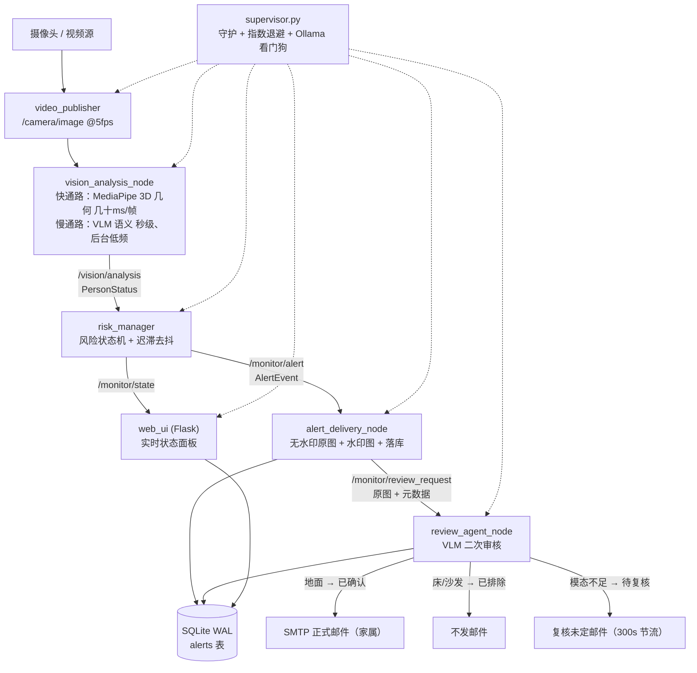

# 养老监护预警系统（Elderly Care Monitor）

基于 **ROS2 + MediaPipe 姿态识别 + 本地视觉大模型（VLM）** 的独居老人跌倒/异常监护系统。

系统实时采集监控画面，用**确定性几何姿态检测**判断「是否有人、是躺是站」，用**本地视觉大模型**做语义复核（区分「倒地」与「上床休息」），通过**风险状态机去抖降误报**，最终以「轻提醒 + 二次审核 + 正式邮件」两级告警推送到家属手机/邮箱，并配套 Web 管理界面。

> 关键词：ROS2 Humble · 多节点分布式 · MediaPipe PoseLandmarker 3D · Ollama / qwen2.5vl / llava · 状态机 · 防误报 · 进程守护自愈


---

## 一、系统架构

```
                 ┌─────────────────────────────────────────────────────────────┐
                 │                      supervisor.py（进程守护）                │
                 │        崩溃自愈 + 指数退避重启 + Ollama 看门狗 + 优雅停机        │
                 └─────────────────────────────────────────────────────────────┘

  摄像头 / 视频源
        │
        ▼
┌────────────────┐   /camera/image   ┌────────────────────┐   /vision/analysis   ┌────────────────┐
│ video_publisher │ ───────────────► │ vision_analysis_node│ ──────────────────► │  risk_manager   │
│  (发布图像流)    │                  │  (混合分析：姿态+语义) │                    │  (风险状态机)    │
└────────────────┘                  └────────────────────┘                    └────────────────┘
                                                                                      │
                                                             /monitor/alert           │ /monitor/state
                                                                                      ▼
                                                                        ┌────────────────────────┐
                                                                        │  alert_delivery_node     │
                                                                        │ 截图水印 + 落库 + 轻提醒   │
                                                                        └────────────────────────┘
                                                                                      │ /monitor/review_request
                                                                                      ▼
                                                                        ┌────────────────────────┐
                                                                        │    review_agent_node     │
                                                                        │ VLM 二次审核 → 正式邮件    │
                                                                        └────────────────────────┘
                                                                                      │
                                                    ┌─────────────────────────────────┴──────┐
                                                    ▼                                        ▼
                                             SMTP 邮件（家属）                        web_ui.py（Flask 管理界面）
```

**5 个 ROS2 节点 + 1 个 Web 服务**，通过 `std_msgs/String + JSON` 传输类型化消息（`PersonStatus` / `AlertEvent`），感知与决策分离。

### 数据流（Mermaid，GitHub 可直接渲染）



**三态审核判决**是防误报的核心：`已确认`（发正式邮件）/ `已排除`（正常休息，不发）/ `待复核`（模型自认看不清，转人工，节流发信）。判不了就说判不了，而不是硬给一个结论。

---

## 二、核心亮点

### 1. 双速混合分析（确定性姿态 + 慢速语义解耦）
- **快速通路（几十 ms/帧）**：MediaPipe PoseLandmarker 用 **3D 世界坐标关键点**判断姿态（躺下/站立/坐着/蹲着）。几何判断是确定性的，不受拍摄角度影响。
- **慢速通路（秒级）**：本地 VLM 只做「位置/表情/肢体」语义判断，后台低频刷新、缓存合并，**不阻塞告警主链路**。
- 关键洞察：7B 视觉模型对空间几何感知不可靠（实测 llava:7b 对「躺下/站立」召回上限仅 **~59%**），而 MediaPipe 3D 几何的躺下召回可达 **~95%**。因此把姿态判断交给几何、把语义判断留给 VLM，各取所长。

### 2. 风险状态机去抖，大幅降误报
单帧分析有噪声（activity 在「坐/站」抖动、risk 在「低/中」跳变），若逐帧告警会刷屏误报。状态机维护随时间演化的状态，**只有风险条件持续超过阈值才触发状态转移**，并管理告警生命周期（触发 / 恢复 / 冷却）。

```
NORMAL ──风险持续中/高──► WATCH ──持续高风险──► ALERT
   ▲                        │                      │
   └────风险回落─────────────┴──────────────────────┘
NORMAL ──画面持续无人──► ABSENT（夜间 20:00 后每日提醒一次）
```

### 3. 两级告警 + VLM 二次审核（防误报核心）
1. **轻提醒**：告警先出「疑似」提醒（截图 + 智能分析总结），家属自行判断是否立即处理。
2. **二次审核**：跌倒/高风险事件驱动调用 VLM（`qwen2.5vl:7b`）复核——**地面 = 确认跌倒发正式邮件；床/沙发 = 正常休息，判定「已排除」不发正式邮件**。

### 4. 进程守护自愈
`supervisor.py` 监控全部子进程，崩溃自动重启（指数退避、稳定运行后计数清零），内置 Ollama 健康检查看门狗，优雅停机（按命令行精确匹配本项目进程，不误杀其它 Python）。

### 5. 工程化细节
- **中文路径兼容**：`cv2.imencode/fromfile` 替代 `imwrite/imread`，规避 Windows 中文路径问题。
- **阻塞 IO 异步化**：SMTP 邮件走 `ThreadPoolExecutor` 后台线程，不卡 ROS2 回调。
- **邮件失败重试自愈**：每 60s 扫描未发送成功的告警，最多重试 3 次。
- **并发友好数据层**：SQLite WAL 模式，每次操作独立连接，支持 Web 与 ROS2 节点多进程读写。

---

## 二之一、从失败到防护机制

监控系统的价值不在于「能检测到」，而在于「出错时不会骗人」。下面每一条都是一次真实事故，
以及它被转化成的长期机制——不是修完就算，而是让同类失败不可能再以同样方式发生。

| # | 现象 | 根因 | 转化成的防护机制 | 验证 |
|---|---|---|---|---|
| 1 | 空房间被判「站立」，`absent ↔ normal` 每几十秒反复跳 | MediaPipe 依据画面底边一点线索**外推出整副骨架**（肩部可见度 0.86，髋/膝/踝 y 坐标在画面外 1.9~3.1），旧逻辑用「8 点可见度均值 ≥ 0.15」判有人 | 关键点 **x/y 超出 [0,1] 一律按不可见**；`person_present` 改为**肩部可见度 ≥ 0.5**；新增 `torso_ok` / `leg_ok` 门控，腿不可见时**不猜站/坐/蹲** | 同一机位：`站立 / vis=0.23 / vfrac=0.98` → `无人 / 0.00 / 0.00` |
| 2 | 状态在「蹲着/坐着」间抖动，告警时有时无 | 单帧噪声，1200 帧内 activity 跳变 **92 次**（每 2.6 s 一次）；真蹲着被切成 40 段、最长仅 8.4 s，永远够不到 15 s 阈值 | 条件判定加**迟滞 `cond_hold_sec = 3.0`**：条件短暂跳走 ≤3 s 内回来不清零、继续累加 | 回放同一 1200 帧序列：久蹲告警 **0 次 → 1 次** |
| 3 | 凌晨服务全部失联，**14 小时无新告警入库**，只剩 6 个孤儿进程 | Ollama 桌面端 `auto_update_enabled=1`，静默执行 `OllamaSetup.exe /VERYSILENT /FORCECLOSEAPPLICATIONS` **强杀推理服务**再升级（`upgrade.log` 停在 0 字节） | 关闭自动更新 + 锁死模型目录；`supervisor.py` 重写：Ollama 前置健康检查、子进程日志落盘、**非阻塞指数退避**重启、绝对解释器路径、停机回收 Ollama | 7 个服务稳定运行，守护日志 0 次重启 |
| 4 | 检测到异常，但 AI 二次审核从没给过结果 | 送审条件写成 `if alert_type in ('fall','high_risk')`，「无人」类告警**从不进审核**，`review_result` 永远为空 | 无人类型同样送审；送审改用**无水印原图**（此前送带水印截图，VLM 只是复读截图顶栏的结论，等于自己批自己） | 端到端 15 s 走完全链路并写库 |
| 5 | 空房间发出「已确认跌倒」正式邮件 | VLM 位置永远给「未知」，落进 `else` 分支被判「已确认」 | **三态判决**：`未知` 不再等于 `已确认`，改判 `待复核` 并单独发「复核未定」邮件（300 s 节流） | 正常休息 16 段视频 32 帧，全部正确排除 |

**第 1 条是这个项目最有价值的一课**：模型不是「漏检」,而是**非常自信地编造了画面外的身体**。
它的输出在格式上完全合法（8 个关键点、合理置信度），只有把坐标本身纳入校验才能发现。
结论：**概率模型的上游必须有确定性的物理约束**，而不是在下游用一个更好的模型去纠正它。

---

## 三、技术栈

| 层次 | 技术 |
|---|---|
| 机器人框架 | ROS2 Humble（Windows pixi 版，无 colcon，按路径运行） |
| 姿态检测 | MediaPipe PoseLandmarker（3D 世界坐标几何判断） |
| 视觉大模型 | Ollama + qwen2.5vl:7b（复核）/ llava:7b（上下文） |
| 状态机 | 自研 `RiskStateMachine`（去抖 + 冷却 + 生命周期管理） |
| Web 界面 | Flask + SQLite + Jinja2（桌面端 / 手机端） |
| 告警投递 | SMTP（SSL）+ Pillow 中文水印截图 |
| 进程管理 | 自研 supervisor（崩溃自愈 + Ollama 看门狗） |

---

## 四、目录结构

```
ros_vision/
├── supervisor.py              # 进程守护：启动全部服务 + 崩溃自愈 + 优雅停机
├── video_publisher.py         # ROS2 节点：发布 /camera/image
├── vision_analysis_node.py    # ROS2 节点：混合分析，发布 /vision/analysis
├── hybrid_analyzer.py         # 姿态(确定) + llava(慢) + 跌落时间特征 → 风险决策
├── pose_detector.py           # MediaPipe 3D 姿态检测（躺下/站/坐/蹲）
├── ollama_analyzer.py         # Ollama 本地 VLM 调用封装
├── alert_delivery_node.py     # ROS2 节点：截图水印 + 落库 + 轻提醒邮件
├── review_agent_node.py       # ROS2 节点：VLM 二次审核 → 正式邮件
├── web_ui.py                  # Flask 管理界面（桌面 / 手机端）
├── recorder_node.py           # 录像节点
├── image_utils.py             # ROS Image <-> numpy 转换
├── elderly_monitor/
│   ├── state_machine.py       # 风险状态机
│   ├── messages.py            # 类型化消息 schema（dataclass）
│   ├── database.py            # SQLite 数据层（并发友好）
│   ├── emailer.py             # 邮件发送封装
│   ├── nodes/risk_manager.py  # 风险状态机 ROS2 节点
│   ├── templates/             # Web 模板
│   └── launch/                # ROS2 launch 文件
├── eval_*.py / eval_*.json    # 离线评测脚本与量化结果
├── test_*.py                  # 单元/回归测试
├── start_all.bat / stop_all.bat  # 一键启停
└── docker-compose.yml         # Ollama 模型服务容器（可选）
```

---

## 五、快速开始

### 环境依赖
- Windows + Python 3.10（与 ROS2 Humble 匹配）
- ROS2 Humble（pixi 版，位于 `E:\ros2\ros2-windows`）
- Ollama（本地运行 `qwen2.5vl:7b` / `llava:7b`）
- 依赖：`rclpy` `opencv-python` `mediapipe` `numpy` `flask` `pillow`

### 运行

```bash
# 1. 启动 Ollama 并拉取模型
ollama serve
ollama pull qwen2.5vl:7b

# 2. 一键启动（启动全部 5 个 ROS2 节点 + Web 界面，进程守护）
start_all.bat

# 3. 停止
stop_all.bat
```

> 注意：`supervisor.py` / `start_all.bat` 内的 ROS2 安装路径、Python 路径需按本机环境调整。摄像头源默认 `0`（本机摄像头），可用环境变量 `CAMERA_SOURCE` 覆盖为视频文件。

### 参数配置（config.yaml）

所有阈值与开关集中在根目录 `config.yaml`，改完重启即可生效，不用动代码：

```yaml
vision:
  analyze_interval: 0.2     # 姿态分析节流，0.2 = 每秒 5 帧
  use_llava: false          # 慢速 VLM 上下文通路（开=更准但更慢更费显存）
  log_interval: 60.0        # 静默日志心跳间隔，0 = 只在状态变化时打
  log_stable_sec: 3.0       # 新状态稳定多久才记一行（防单帧抖动刷屏）
  verbose_log: false        # true = 每帧都打日志，仅排查时开

risk:
  fall_sec: 2.0             # 连续 2s 躺下 -> 立即告警
  squat_sec: 15.0           # 连续 15s 蹲着 -> 告警
  watch_sec: 10.0           # 连续 10s 中风险 -> 关注
  alert_sec: 20.0           # 连续 20s 高风险 -> 告警
  absent_sec: 15.0          # 连续 15s 无人 -> 判定无人（去抖）
  recover_sec: 30.0         # 连续 30s 回落 -> 恢复
  cooldown_sec: 300.0       # 同类告警冷却，调大 = 更安静

review:
  model: qwen2.5vl:7b
  pending_email_interval: 300.0   # 「复核未定」邮件节流

supervisor:
  stable_seconds: 60
  max_log_mb: 5             # 单个日志超过 5MB 自动轮转成 .log.1
  restart_delay: 5.0
```

优先级：**命令行 `--ros-args -p 名字:=值` > `config.yaml` > 代码内默认值**。节点启动时会把生效阈值打进日志（如 `生效阈值(来自 config.yaml，-p 可覆盖)：跌倒<2s ...`），方便确认到底用了哪一套。

配置文件路径可用环境变量 `MONITOR_CONFIG` 指向别处。

### Web 界面
- 桌面端：`http://本机IP:5000`
- 手机端：`http://本机IP:5000/mobile`

---

## 六、评测结果

| 指标 | 结果 |
|---|---|
| 正向链路（跌倒→地面→确认→正式邮件） | e2e 通过（qwen2.5vl 置信 0.90，llava 0.80） |
| 反向链路（正常休息防误报） | 16 段视频 32 帧，床/沙发/椅子正常休息全部正确排除 |
| MediaPipe 3D 躺下召回 | ~95%（确定性几何，阈值扫描最优） |
| llava:7b 姿态召回上限 | ~59%（7B VLM 空间几何不可靠，故交给几何） |
| 姿态检测延迟 | 几十 ms/帧（快速通路） |
| VLM 二次审核 | 13~33s/帧（事件驱动，不占热路径） |

---

## 七、隐私与安全说明

本项目为本地部署系统，**仓库已排除所有敏感数据**：
- `data/monitor.db`（含 SMTP 授权码、密码哈希、手机号）
- `data/secret_key`（Flask 会话密钥）
- `alerts/`（含老人影像的告警截图）
- `models/`、`test_videos/`（大体积模型与测试视频，可另行下载）

如需部署，首次运行会自动初始化空数据库，再到 Web 设置页填写 SMTP 配置即可。

---

## 八、License

MIT — 见 [LICENSE](./LICENSE)。个人作品项目，供学习与展示使用。
